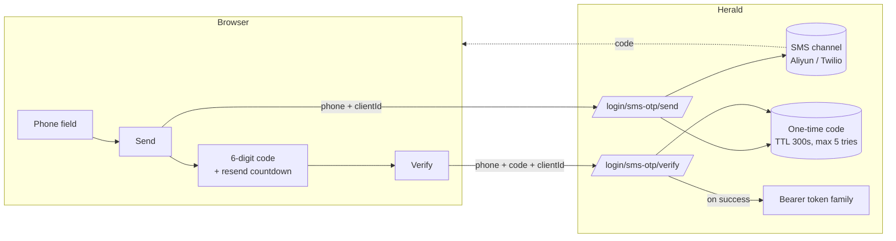

Herald's phone login gives a realm two entrances for a phone number: a one-time SMS code that replaces the password step, and the password box itself, which accepts a bound phone number as the identifier. Phone numbers are bound and verified by the user after registration; email stays the mandatory account identity. A Realm Admin configures an SMS channel (Aliyun or Twilio) and turns the single *Phone login* switch on under *Settings*. The switch refuses to turn on until the channel is configured.

This is a first-factor login method, not a second factor. TOTP and Passkey remain the second-factor options. SMS-code login reuses the password-login completion chain, so an account with TOTP or Passkey enabled still goes through its second factor, and stale legal consent still gates the token.

It exists for realms whose users live on their phones, mainly in China: a phone number is what those users remember, and SMS reaches them where email does not.

## Who this is for

Realm Admins serving phone-first users, and developers integrating the hosted auth pages or building a Custom User UI who need to know the request shape and the branches the endpoints return. It is not an API reference — for endpoint and schema details, see the [OpenAPI reference](/docs/openapi).

## What problem it solves

Some users do not remember which email they registered with, and typing a password on a phone is friction. Phone login trades both for proof that the user holds the phone number. Two costs come with that trade. Every SMS costs the realm money, so send budgets are tighter than email's and every send path shares one per-(realm, phone) budget. And phone numbers get recycled by carriers: Herald treats a verified SMS code as proof of possession, same trust level as email OTP, and gives admins unbind/rebind tools for the after-the-fact cases (see below).

## How it works

The SMS-code flow is two unauthenticated steps:

1. **Send.** The user enters their phone number, in any writing form (bare 11 digits, `+86`/`0086` prefix, separators). The frontend posts `{ clientId, phone, turnstileToken }` to `/api/auth/{realmId}/login/sms-otp/send`. If the number matches a bound phone, Herald texts a 6-digit code. The response carries `expiresInSeconds` for the countdown.
2. **Verify.** The user types the code. The frontend posts `{ clientId, phone, code, turnstileToken }` to `/api/auth/{realmId}/login/sms-otp/verify`. On success the response is a `BrowserTokenResponse` (the same shape password login returns), and the frontend stores the tokens the same way.

The public endpoint `GET /api/auth/{realmId}/phone-login/status` returns `{ enabled }` so a frontend can hide or show the SMS entry without admin permissions. It fails closed: a missing or malformed switch reads as disabled.

A number that matches no account gets a 409 `phone_not_registered` — no account is created and no SMS is sent; phone login has no auto-register branch. A registered-but-disabled account gets a byte-identical 200 with no code stored or sent, so send responses cannot be used to enumerate numbers.

The `clientId` in both calls is the Client App the login belongs to. It determines the Turnstile site key, the rate-limit bucket, and which browser token family is issued.

The browser SDK `herald-auth-web` wraps both steps: `loginWithSmsOtp.send({ phone, turnstileToken })` and `loginWithSmsOtp.verify({ phone, code, turnstileToken })`. The 409 `phone_not_registered` outcome resolves as `{ kind: 'conflict' }` instead of throwing, so a Custom User UI can guide the user to register.

### Phone as a password-login identifier

With the switch on, the existing password endpoint also accepts a phone number: the user types it into the `username` field of `POST /api/auth/{realmId}/login`, and the server looks identifiers up in the order email → phone → username. The number is normalized to E.164 first, and the raw `username` value stays in the lookup as a fallback, so a purely numeric username that is not a valid phone number still matches exactly. No request field changed, so existing clients and SDKs get the capability without any change. The LDAP entrance is a separate endpoint and is untouched.

## Binding, changing, and unbinding

Registration never collects a phone number. A signed-in user binds one under *Security*:

1. **Reauth.** Bind, change, and unbind each start with a fresh reauth ticket (password, TOTP, or Passkey — any one factor), and are only accepted from the user's own first-party browser session; restricted consent sessions and third-party portal sessions do not hold the scope.
2. **Code.** The user enters the new number, the frontend requests a code (`POST /api/user/phone/bind/send`, which consumes the ticket), and confirms it (`POST /api/user/phone/bind/confirm`). Possession of the code is the proof — confirm consumes no reauth ticket.
3. **Done.** A bound phone equals a verified phone; there is no separate "verified" flag. Changing to a new number keeps the old binding until the new number's code verifies, in one write.

Unbinding (`POST /api/user/phone/unbind`, reauth required) leaves email/username + password login working. Another account in the same realm cannot bind the same number — uniqueness is enforced on the normalized E.164 form, so different writing forms of one number conflict too. Phones are always shown masked (`138****8000`), derived server-side; the frontend never sees the raw number.

Realm Admins get after-the-fact tools in user management: masked display in list and detail, search by the full number, unbind (confirm dialog + audit), and rebind. An admin rebind sends a code to the new number and only takes effect once that code verifies, preserving "bound = possession verified" even against a careless or malicious admin. All of it is audited with masked values only, and none of it is limited by the realm switch — it is account-data maintenance.

Account deletion anonymizes the phone column along with email, after which the number reads as unregistered at every login entrance.

## Realm configuration

Two things live under *Settings*: the SMS channel and the switch. Permissions match the rest of Settings: reading needs `settings.view`, saving needs `settings.manage`.

The **SMS channel** is per realm: provider (Aliyun for domestic China, Twilio for international), provider credentials, sign name / template identifiers, and a default country code used to normalize numbers typed without one. Credential fields are masked on read and only accepted in plaintext while editing, like the email provider. Changes are audited. *Test SMS* sends a real login-path code to a number you choose, at 1 per minute per admin, so a channel can be verified before it is trusted. The SMS body itself — wording, sign name, template — is registered with the provider; Herald passes the code as a template variable and does not store or edit message text.

The **switch** is a single *Phone login* toggle covering both entrances (SMS-code login and the phone identifier in password login), plus the default country code. Enabling it requires a fully configured channel: the console shows the switch disabled with a tooltip until then, and the API rejects the enable call with a 400 `Cannot enable phone login without SMS configuration`. Disabling is always allowed. While the switch is on, the channel's config rows cannot be deleted, so an enabled realm cannot end up with a dead channel. Turning the switch off degrades smoothly: the login entrances disappear, bound users keep signing in with password / TOTP / Passkey, the binding stays visible read-only under *Security*, and nothing is lost — turning the switch back on needs no re-binding.

Every realm starts with the switch off.

## Limits and rate limiting

These are enforced server-side; the frontend cannot relax them. Send budgets are tighter than email's because every send is billable.

| Limit | Value |
|-------|-------|
| Code lifetime | 300 seconds (5 minutes) |
| Max verify attempts per code | 5 |
| Send rate limit, per phone | 1 per 60 seconds |
| Send rate limit, per IP | 5 per 60 seconds |
| Verify rate limit, per phone | 5 per 60 seconds |
| Verify rate limit, per IP | 10 per 60 seconds |
| Test SMS, per admin | 1 per 60 seconds |

The per-phone send limit is a shared budget: login, binding, admin rebind, and test sends all draw on the same per-(realm, phone) bucket, so no entrance can be used to send more than one paid SMS per number per minute. After 5 wrong codes the code is invalidated. A successful verify consumes the code; it cannot be replayed. A newer code replaces an older one.

## Relationship to the other login methods

Phone login is a parallel first-factor option:

- **Password login** stays available, and now also accepts a bound phone number as the identifier (switch on).
- **Email-code login** is the same two-step shape for email, with one difference: email can auto-register unknown addresses; phone never creates an account.
- **TOTP and Passkey** second factors still run after any first factor, SMS included.
- **LDAP** login is a separate entrance and unaffected by the phone branch.

A user who signs in by SMS code gets the same `BrowserTokenResponse` and the same token-family semantics (rotating refresh, reuse detection, revocation) as any other login method.

## Turnstile

Both send and verify are Turnstile-gated when the Client App has `turnstile_enabled` on — unlike email-code login, where only send is. A Turnstile token is single-use, so each call needs its own fresh `turnstileToken` and the frontend re-renders the widget between steps and after a resend. See [Custom User UI](/docs/integration/custom-user-ui) for how Turnstile is configured per Client App.

## Related docs

- [Email code login](/docs/auth/email-otp) — the email twin of this flow, including its auto-register branch
- [Custom User UI](/docs/integration/custom-user-ui) — the self-built frontend path, including Turnstile and token storage
- [White-label](/docs/customization/branding) — branding the hosted auth pages where the SMS entry also appears
- [Configuration](/docs/configuration) — Realm security settings
- [OpenAPI reference](/docs/openapi) — endpoint and schema details for the send, verify, status, phone-management, and admin endpoints
