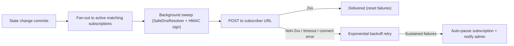

Herald pushes realm state changes to your backend over outbound webhooks. Instead of polling user, role, or subscription APIs, your Realm Admin registers a public callback URL and selects event categories. Whenever a matching change takes effect, Herald records an event and POSTs a signed JSON envelope to that URL.

Delivery is **at-least-once**. The same event may arrive more than once, and events may arrive out of order. Every event carries a globally unique `id` for deduplication and an `occurredAt` timestamp for ordering.



Events are never sent inline on API request paths. A background worker (`OutboundDeliveryJob`) claims pending rows with `FOR UPDATE SKIP LOCKED` and delivers them asynchronously, so a slow or failing receiver never blocks user or billing requests.

## 1. Prepare a Subscription

Open **Webhooks** in the Herald admin console (`/{realmId}/manage/webhooks`, or `/manage/webhooks` on a custom domain). Access requires `webhooks.view` to read and `webhooks.manage` to create or modify subscriptions; both permissions are granted to `realm-admin` by default.

1. Click **Add Subscription** and enter a **public callback URL** (`http` or `https`, up to 2048 characters, no userinfo or URL fragment). Private, loopback, and link-local addresses are rejected at registration time in both the form and the backend, and Herald re-checks resolved DNS IPs at connection time to block DNS rebinding.
2. Select at least one event category: `user_lifecycle`, `role_events`, or `subscription_lifecycle`.
3. After saving, Herald opens a one-time secret reveal page showing the signing secret (`whsec_...`). Copy it immediately. If you refresh or leave that page, the plaintext secret cannot be retrieved again; rotate the secret to generate a new one (see [§5 Key Rotation](#5-key-rotation)).

Each realm can hold up to 20 subscriptions, and each subscription has its own signing secret and category filter. A subscription is always in one of three states:

- **Active**: receives matching events. Can be manually disabled.
- **Disabled**: manually stopped by an admin; no events are delivered. Can be re-enabled.
- **Paused (system)**: automatically paused after sustained delivery failures. Can be edited (changing the URL resets the consecutive-failure counter) and resumed, or deleted.

## 2. Verify the Signature

Every delivery POST carries these headers:

| Header | Meaning |
|--------|---------|
| `Content-Type` | `application/json` (fixed) |
| `X-Herald-Event-Id` | Event ID, equal to `body.id`, for log correlation |
| `X-Herald-Event-Type` | Event type (see [§6 Event Catalog](#6-event-catalog)) |
| `X-Herald-Delivery-Id` | Delivery task ID. Identical across retries of one delivery; a different delivery ID with the same event ID means a duplicate push |
| `X-Herald-Timestamp` | Signature timestamp (Unix seconds) |
| `X-Herald-Signature` | `v1={hex}`, the HMAC-SHA256 signature |

The signature uses a Stripe-style timestamped scheme:

```text
signedPayload = "{X-Herald-Timestamp}.{requestBody}"   // raw request bytes
signature     = hex( HMAC-SHA256( key = subscription secret, msg = signedPayload ) )
X-Herald-Signature: v1={signature}
```

Verify every request before parsing or acting on the payload:

1. Compute HMAC-SHA256 over `{timestamp}.{rawBody}` using the **raw** request bytes. Never re-serialize parsed JSON, because key order or whitespace differences break the hash.
2. Compare against `X-Herald-Signature` in **constant time**.
3. Reject timestamps more than **5 minutes** (300 seconds) away from your system clock to defend against replays.

Language-agnostic pseudocode:

```text
function verify(secret, timestampHeader, signatureHeader, rawBody):
    if timestampHeader is empty or signatureHeader is empty: reject
    if abs(now() - parseUnixSeconds(timestampHeader)) > 300: reject
    expected = "v1=" + hex(HMAC-SHA256(secret, timestampHeader + "." + rawBody))
    if !constantTimeEquals(expected, signatureHeader): reject
    accept
```

Node.js (Express) verification helper:

```js
import { createHmac, timingSafeEqual } from "node:crypto";

function verifyHeraldSignature(secret, timestamp, signature, rawBody) {
  if (!timestamp || !signature) return false;

  const ts = Number(timestamp);
  if (!Number.isFinite(ts) || Math.abs(Date.now() / 1000 - ts) > 300) {
    return false;
  }

  const expected = createHmac("sha256", secret)
    .update(`${timestamp}.${rawBody.toString("utf8")}`)
    .digest("hex");

  const a = Buffer.from(`v1=${expected}`, "utf8");
  const b = Buffer.from(signature, "utf8");
  return a.length === b.length && timingSafeEqual(a, b);
}

app.post("/webhooks/herald", express.raw({ type: "application/json" }), (req, res) => {
  const ok = verifyHeraldSignature(
    process.env.HERALD_WEBHOOK_SECRET,
    req.get("X-Herald-Timestamp"),
    req.get("X-Herald-Signature"),
    req.body,
  );
  if (!ok) {
    return res.status(400).send("invalid signature");
  }

  const event = JSON.parse(req.body.toString("utf8"));
  // Deduplicate by event.id, then handle (see §3 and §7)
  res.status(200).send();
});
```

Respond with any **2xx** status code to acknowledge delivery. Anything else (3xx redirects, 4xx, 5xx, connection error, or timeout) counts as a failure and enters retry. Herald disables HTTP redirects and ignores your response body.

## 3. Idempotency and Ordering

Because delivery is at-least-once, make your handler safe to run multiple times for the same event:

- **Deduplicate by `id`** (`body.id` / `X-Herald-Event-Id`). Store processed event IDs durably (for example in a database table with a unique constraint on `event_id`). Keeping IDs for a few days covers the full retry window.
- **Arbitrate out-of-order events with `occurredAt`.** If you already applied a newer state change for the same user or subscription, ignore an older event.
- `X-Herald-Delivery-Id` stays constant across retries of one delivery task, while `X-Herald-Event-Id` (`body.id`) identifies the state change itself. When one state change fans out to multiple subscriptions in the same realm, all deliveries share the same event `id`.

## 4. Retries, Auto-Pause, and Reconciliation

Failed deliveries retry with exponential backoff (starting around 1 minute, doubling per attempt, capped at 8 hours by default). Exact intervals and thresholds are deployment-tunable runtime settings in [`[webhook_delivery]`](/docs/configuration#webhook_delivery), not a fixed product contract.

After sustained consecutive failures, Herald **auto-pauses only that subscription** (sibling subscriptions in the same realm keep running), drops its remaining pending deliveries, and notifies your realm admins:

- **Admin console (always available)**: the subscription badge switches to **Paused (system)** with a reason popover displaying the last failure summary (HTTP status code or error category only, never your response body), consecutive failure count, pause timestamp, and a reminder that resuming does not replay missed events.
- **Email (conditional)**: if the realm has a configured mail channel, Herald also emails realm admins. If no mail channel is configured, the Webhooks page shows an informational notice when any subscription is paused.

While a subscription is paused or disabled, events are **not delivered and not replayed**. When you fix your endpoint, edit the callback URL if needed (changing the URL resets the failure counter), and click **Resume**. Close any gap from the outage by reconciling against Herald's existing query APIs (users, roles, subscriptions) using `occurredAt`.

## 5. Key Rotation

You can rotate a subscription's signing secret from the **Webhooks** list. Rotation takes effect immediately for **every subsequent delivery attempt, including pending retries**. To rotate without dropping deliveries:

1. Update your receiver to accept both the current secret and the upcoming secret during the transition (try the current secret first, then fall back to the new one, or store a small list of active secrets).
2. Click **Rotate Secret** in Herald and copy the new secret from the one-time reveal page.
3. Deploy the new secret to your receiver, then remove the old secret once deliveries signed with the old key stop arriving.

The subscription list and edit page show `secretHint` (the last 4 characters, such as `…wxyz`) so you can verify which key version is active.

## 6. Event Catalog

Every delivery body uses the same JSON envelope:

```json
{
  "id": "0193d0c0-0000-7000-8000-000000000001",
  "type": "role.granted",
  "realmId": "my-realm",
  "createdAt": "2026-11-20T12:00:00.100Z",
  "occurredAt": "2026-11-20T11:59:58.000Z",
  "data": {
    "userId": "0193d0bf-0000-7000-8000-000000000042",
    "roleId": "0193d0b0-0000-7000-8000-000000000009",
    "roleName": "pro",
    "source": "payment",
    "expiresAt": "2026-12-20T11:59:58.000Z"
  }
}
```

| Field | Type | Meaning |
|-------|------|---------|
| `id` | string (UUIDv7) | Globally unique idempotency key; identical across all deliveries of one state change |
| `type` | string | Event type (table below); future breaking changes use a `.v2` type name |
| `realmId` | string | Realm the event belongs to |
| `createdAt` | string (RFC3339) | When Herald recorded the event |
| `occurredAt` | string (RFC3339) | When the state change took effect; use this for ordering arbitration |
| `data` | object | Type-specific payload (data-minimized: no email, nickname, audit details, or internal payment references) |

Catalog (category, type, `data` fields, and trigger):

| Category | Type | `data` fields | Fires when |
|----------|------|---------------|------------|
| `user_lifecycle` | `user.created` | `userId` | A user is created via admin console, ext API, or self-service registration |
| `user_lifecycle` | `user.disabled` | `userId` | A user's status flips to disabled |
| `user_lifecycle` | `user.deleted` | `userId` | A user is deleted or anonymized (admin or self-service) |
| `role_events` | `role.granted` | `userId`, `roleId`, `roleName`, `source` (`manual`\|`payment`), `expiresAt` (nullable) | A role is granted manually or by payment fulfillment (both sources emit) |
| `role_events` | `role.revoked` | `userId`, `roleId`, `roleName`, `source` (`manual`\|`payment`) | A role is revoked manually, on refund, or on subscription cancel |
| `subscription_lifecycle` | `subscription.activated` | `userId`, `subscriptionId`, `entitlementKey` (nullable), `currentPeriodEnd` (nullable) | A subscription enters an entitlement-holding state (first activation, `incomplete` to `active`, trial start, dispute recovery) |
| `subscription_lifecycle` | `subscription.renewed` | `userId`, `subscriptionId`, `entitlementKey` (nullable), `currentPeriodStart`, `currentPeriodEnd` | A renewal payment succeeds |
| `subscription_lifecycle` | `subscription.expired` | `userId`, `subscriptionId`, `entitlementKey` (nullable) | A subscription flips to expired |
| `subscription_lifecycle` | `subscription.refunded` | `userId`, `subscriptionId` (nullable) | A full refund or IAP revocation is established (`subscriptionId` is `null` for one-time purchases) |

`roleName` is a snapshot at event time. `expiresAt` applies only to grants (payment grants carry the period end; manual grants are `null`). The envelope and existing `data` fields evolve additively: new fields and new event types are non-breaking, while breaking changes ship as new type names (`.v2`) or a new envelope version.

## 7. Consumption Examples

The handler below wires signature verification, `event.id` deduplication, and the two primary consumer patterns: **paywall unlock in seconds** (`role.granted`) and **instant account takedown** (`user.disabled`).

```js
app.post("/webhooks/herald", express.raw({ type: "application/json" }), async (req, res) => {
  const ok = verifyHeraldSignature(
    process.env.HERALD_WEBHOOK_SECRET,
    req.get("X-Herald-Timestamp"),
    req.get("X-Herald-Signature"),
    req.body,
  );
  if (!ok) {
    return res.status(400).send("invalid signature");
  }

  const event = JSON.parse(req.body.toString("utf8"));

  // INSERT INTO processed_webhook_events (event_id) VALUES ($1) ON CONFLICT DO NOTHING
  const isNew = await recordEventIfNew(event.id);
  if (!isNew) {
    return res.status(200).send();
  }

  switch (event.type) {
    case "role.granted": {
      // Paywall unlock in seconds: payment fulfillment grants the mapped role
      // and pushes role.granted (source: "payment", expiresAt = period end).
      await unlockUserRole({
        userId: event.data.userId,
        roleName: event.data.roleName,
        expiresAt: event.data.expiresAt,
        occurredAt: event.occurredAt,
      });
      break;
    }
    case "role.revoked": {
      await revokeUserRole({
        userId: event.data.userId,
        roleName: event.data.roleName,
        occurredAt: event.occurredAt,
      });
      break;
    }
    case "user.disabled": {
      // Instant account takedown: freeze access and revoke local app sessions.
      await terminateAppSessions(event.data.userId, event.occurredAt);
      break;
    }
    default:
      break;
  }

  res.status(200).send();
});
```

## 8. Troubleshooting

| Symptom | Cause | Recovery |
|---------|-------|----------|
| Saving a subscription returns `invalid_endpoint_url` (or inline error in the form) | The URL is not `http`/`https`, contains userinfo or `#fragment`, exceeds 2048 characters, or points to a private/loopback/link-local IP (including a hostname whose DNS resolves only to non-public IPs) | Use a publicly reachable HTTPS endpoint. For local development, expose your receiver through a public tunnel |
| Saving returns `duplicate_endpoint_url` (HTTP 409) | The same callback URL is already registered in this realm | Edit the existing subscription to adjust its categories instead of creating a duplicate |
| Saving returns `subscription_limit_exceeded` | The realm already has 20 subscriptions (the per-realm fan-out guard) | Delete unused subscriptions or consolidate event categories onto fewer endpoints |
| Deliveries fail with `HTTP 301` / `HTTP 302` or `redirect rejected` | Herald disables redirects on outbound deliveries (`redirect::Policy::none()`) as part of SSRF protection | Register the final destination URL directly (for example include or omit the trailing slash to match your server) |
| Signature verification fails right after key rotation | Rotating the secret immediately switches signing for all subsequent attempts, including pending retries | Accept both old and new secrets during rotation (see [§5](#5-key-rotation)), and verify `secretHint` in the admin console |
| Signature verification fails on valid deliveries | The verifier computed HMAC over re-serialized JSON instead of the raw request bytes, or the server clock drifted beyond 5 minutes | Use `express.raw` (or your framework's raw body bytes) before `JSON.parse`, and check NTP clock sync |
| Subscription shows **Paused (system)** and events during the outage are missing | Consecutive delivery failures crossed the auto-pause threshold; paused subscriptions drop pending deliveries and never backfill | Open the paused-reason popover to inspect `lastError`, fix your endpoint (or edit the URL), click **Resume**, and reconcile missed state via Herald's query APIs |
| **Webhooks** menu does not appear in the admin console | The operator lacks `webhooks.view` (or `webhooks.manage` for write actions) | Grant a role that includes `webhooks.view` / `webhooks.manage` (`realm-admin` holds both by default) |
