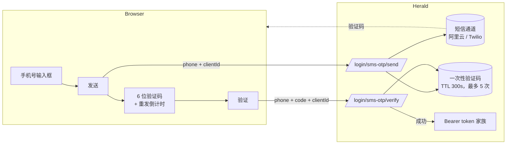

Herald 的手机号登录给一个手机号提供两个入口：一次性短信验证码替代密码这一步；密码登录框本身也接受已绑定的手机号作为登录标识。手机号由用户注册后自助绑定并验证，email 仍是账户必填身份。Realm 管理员在 *Settings* 配置短信通道（阿里云或 Twilio），再开启单一的 *手机号登录* 开关；通道未配置时开关无法开启。

这是一种第一因素登录方式，不是第二因素。TOTP 和 Passkey 仍然是第二因素选项。短信验证码登录复用密码登录的完成链路：启用了 TOTP 或 Passkey 的账号仍要走第二因素，协议同意过期时同样会拦下 token。

它服务的是用户以手机为主的 Realm，主要在国内：这类用户记得住手机号，短信在他们可达而邮件不一定。

## 适合谁

服务手机优先用户的 Realm 管理员，以及集成 Herald 托管登录页或自建 Custom User UI、需要了解请求结构和端点分支的开发者。这不是 API 参考——端点和 schema 细节见 [OpenAPI 参考](/docs/openapi)。

## 解决什么问题

有些用户记不清注册用的邮箱，在手机上输密码也是摩擦。手机号登录用"用户持有这个号码"替换掉这两样。代价有两个。每条短信都要花 Realm 的钱，所以发送预算收紧于邮箱口径，且所有发送路径共享同一个按 (realm, 手机号) 的预算。号码会被运营商二次放号：Herald 把验证通过的短信验证码视为占有证明，信任级别与邮箱验证码一致，并给管理员提供解绑/换绑的事后处置工具（见下文）。

## 工作原理

短信验证码流程是两个无需认证的步骤：

1. **发送。** 用户输入手机号，书写形式不限（裸 11 位、`+86`/`0086` 前缀、分隔符都可以）。前端把 `{ clientId, phone, turnstileToken }` POST 到 `/api/auth/{realmId}/login/sms-otp/send`。号码命中某个已绑定手机时，Herald 发送一个 6 位验证码。响应里带 `expiresInSeconds`，前端可以据此显示倒计时。
2. **验证。** 用户输入验证码，前端把 `{ clientId, phone, code, turnstileToken }` POST 到 `/api/auth/{realmId}/login/sms-otp/verify`。成功时响应是一个 `BrowserTokenResponse`（和密码登录返回的结构相同），前端用同样的方式存储 token。

公开端点 `GET /api/auth/{realmId}/phone-login/status` 返回 `{ enabled }`，前端不需要管理员权限就能据此隐藏或显示短信入口。它 fail-closed：开关行缺失或损坏一律读作关闭。

不匹配任何账号的号码得到 409 `phone_not_registered`——不创建账户、不发送短信；手机通道没有自动注册分支。已注册但被禁用的账号返回与正常发送逐字节一致的 200，不落码不发送，因此 send 响应不能用来枚举号码。

两个请求里的 `clientId` 是这次登录所属的 Client App。它决定了 Turnstile 的 site key、限速桶，以及签发哪个浏览器 token 家族。

浏览器 SDK `herald-auth-web` 封装了这两步：`loginWithSmsOtp.send({ phone, turnstileToken })` 和 `loginWithSmsOtp.verify({ phone, code, turnstileToken })`。409 `phone_not_registered` 以 `{ kind: 'conflict' }` 的形式 resolve 而不是抛错，Custom User UI 可以据此引导用户去注册。

### 手机号作为密码登录标识

开关开启后，既有的密码登录端点也接受手机号：用户在 `POST /api/auth/{realmId}/login` 的 `username` 字段里输入手机号，服务端按 email → phone → username 的顺序查找标识。号码先规范化为 E.164，原始 `username` 值仍保留在查找中作为回退，因此不是有效手机号的纯数字用户名仍然精确匹配。请求字段没有任何变化，既有客户端和 SDK 无需改动即获得该能力。LDAP 登录是独立端点，不受影响。

## 绑定、换绑与解绑

注册流程不收集手机号。已登录用户在 *Security* 页自助绑定：

1. **Reauth。** 绑定、换绑、解绑都先要求一张新鲜的 reauth 票据（密码、TOTP、Passkey 任一因素），且只接受用户本人的第一方浏览器会话；受限同意会话和第三方门户会话不持有对应 scope。
2. **验证码。** 用户输入新号码，前端请求验证码（`POST /api/user/phone/bind/send`，消耗票据），再确认（`POST /api/user/phone/bind/confirm`）。占有验证码就是证明——confirm 不消耗 reauth 票据。
3. **生效。** 已绑定即已验证，没有独立的"已验证"标记。换绑时新号码验证码验证通过前旧绑定保持不变，验证后一次写入完成替换。

解绑（`POST /api/user/phone/unbind`，需 reauth）后账号仍可用邮箱/用户名加密码登录。同 Realm 的另一个账号不能绑定同一号码——唯一性建立在规范化 E.164 形式上，同一号码的不同书写形式也会冲突。手机号一律脱敏展示（`138****8000`），由服务端派生；前端拿不到原始号码。

Realm 管理员在用户管理中拿到事后处置工具：列表与详情脱敏展示、按完整号码搜索、解绑（二次确认 + 审计）、换绑。管理端换绑向新号码发送验证码，验证通过才生效，即使面对疏忽或恶意的管理员也维持"已绑定 = 已验证占有"。所有操作只把脱敏值写进审计，且都不受 Realm 开关限制——这是账号数据维护。

账户注销时手机号列随 email 一起匿名化，此后该号码在每个登录入口都读作未注册。

## Realm 配置

*Settings* 下有两样东西：短信通道和开关。权限模型和 Settings 其余部分一致：读取需要 `settings.view`，保存需要 `settings.manage`。

**短信通道**按 Realm 配置：服务商（阿里云=国内、Twilio=国际）、服务凭证、签名名/模板标识，以及用于解析不带国家码输入的默认国家码。凭证类字段读取时脱敏、仅编辑时接受明文，与邮件服务商一致。变更记审计。*测试短信* 向你指定的号码发送一条真实登录链路验证码，每个管理员每分钟限 1 条，让通道在被信任之前先被验证。短信正文本身（文案、签名、模板）在服务商侧报备；Herald 把验证码作为模板变量传递，不存储也不编辑正文。

**开关**是单一的 *手机号登录* 开关，同时覆盖两个入口（短信验证码登录和密码登录的手机号标识），并承载默认国家码。开启要求短信通道已完整配置：此前控制台的开关处于禁用状态（悬停提示原因），直接调用 API 启用则返回 400 `Cannot enable phone login without SMS configuration`。关闭不受限制。开关开启期间，通道的配置行不能被删除，因此不会出现"开关开着但通道已死"的状态。关闭是平滑降级：登录入口消失，已绑定用户继续用密码 / TOTP / Passkey 登录，*Security* 页保留已绑定手机号的只读展示，数据不丢——重新开启后无需重新绑定。

每个 Realm 初始都是关闭。

## 限制和限速

这些都在服务端强制执行，前端无法绕过。发送预算收紧于邮箱口径，因为每次发送都产生真实费用。

| 限制项 | 取值 |
|-------|-------|
| 验证码有效期 | 300 秒（5 分钟） |
| 每个验证码的最大验证次数 | 5 |
| 发送限速，按手机号 | 60 秒内 1 次 |
| 发送限速，按 IP | 60 秒内 5 次 |
| 验证限速，按手机号 | 60 秒内 5 次 |
| 验证限速，按 IP | 60 秒内 10 次 |
| 测试短信，按管理员 | 60 秒内 1 次 |

按手机号的发送限额是共享预算：登录、绑定、管理端换绑、测试短信全部消耗同一个按 (realm, 手机号) 的桶，任何入口都不能绕开"每个号码每分钟最多一条付费短信"。输错 5 次后验证码失效。验证成功会消费掉验证码，不能重放。新验证码覆盖旧验证码。

## 和其他登录方式的关系

手机号登录是一个并行的第一因素选项：

- **密码登录** 仍然可用，开关开启后还接受已绑定手机号作为登录标识。
- **邮箱验证码登录** 是同构的邮箱版本，有一个差异：邮箱可以对未注册地址自动注册；手机通道永不建号。
- **TOTP 和 Passkey** 第二因素在任何第一因素之后照常运行，短信登录也不例外。
- **LDAP** 登录是独立入口，不受手机号分支影响。

用户通过短信验证码登录后，拿到和其他登录方式一样的 `BrowserTokenResponse` 结构，以及一样的 token 家族语义（轮换 refresh、复用检测、撤销）。

## Turnstile

当 Client App 开启了 `turnstile_enabled` 时，send 和 verify 都受 Turnstile 保护——这与邮箱验证码登录不同，那里只有 send 需要。Turnstile token 一次性，每次调用都要带新鲜的 `turnstileToken`，前端在步骤之间和重发之后都会重新渲染组件。Turnstile 如何按 Client App 配置见 [Custom User UI](/docs/zh/integration/custom-user-ui)。

## 相关文档

- [邮箱验证码登录](/docs/zh/auth/email-otp) — 同构的邮箱版本，含自动注册分支
- [Custom User UI](/docs/zh/integration/custom-user-ui) — 自建前端路径，包括 Turnstile 组件和 token 存储
- [White-label](/docs/zh/customization/branding) — 给 Herald 托管的登录页做品牌定制，短信入口也会出现在这些页面上
- [配置](/docs/zh/configuration) — Realm 安全设置
- [OpenAPI 参考](/docs/openapi) — send、verify、status、手机号管理与管理端端点的细节和 schema
