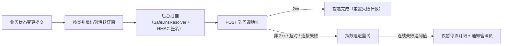

Herald 通过出站 Webhook 把 Realm 内的状态变更推送到你的后端。Realm 管理员登记一个公网回调地址并勾选事件类别后，每当匹配的状态变更生效，Herald 就会向该地址 POST 一个带签名的 JSON 事件信封，不必再轮询用户、角色或订阅 API。

投递遵循 **at-least-once** 语义。同一事件可能送达多次，事件也可能乱序到达。每个事件携带全局唯一的 `id` 供幂等去重，并携带 `occurredAt` 供乱序裁决。



事件不在 API 请求线程内直接外发。后台任务 `OutboundDeliveryJob` 用 `FOR UPDATE SKIP LOCKED` 认领待投递记录并异步外发，慢响应或故障接收端不会阻塞正常业务请求。

## 1. 准备订阅

在 Herald 管理台打开 **Webhooks**（主域名路径 `/{realmId}/manage/webhooks`，自定义域名路径 `/manage/webhooks`）。查看需要 `webhooks.view` 权限，创建和修改需要 `webhooks.manage` 权限，`realm-admin` 默认同时持有这两项。

1. 点击**新建订阅**，填写**公网回调地址**（仅允许 `http` / `https`，最长 2048 字符，不允许携带 userinfo 或 `#fragment`）。前端表单和后端都会在登记时拒绝私网、环回和链路本地地址，投递连接时还会再次核查 DNS 解析结果以防止 DNS rebinding。
2. 勾选至少一个事件类别：`user_lifecycle`、`role_events` 或 `subscription_lifecycle`。
3. 保存后进入一次性密钥展示页，页面展示以 `whsec_` 开头的签名密钥。请立即复制保存。刷新或离开该页后无法再查看明文密钥，遗失时通过轮换生成新密钥（见 [§5 密钥轮换](#5-密钥轮换)）。

每个 Realm 最多创建 20 个订阅，每个订阅拥有独立的签名密钥和类别过滤。订阅处于以下三种状态之一：

- **活跃（Active）**：正常接收匹配事件，管理员可手动停用。
- **停用（Disabled）**：管理员手动停用，不再接收事件，可随时重新启用。
- **已暂停（系统，Paused）**：持续投递失败后由系统自动暂停。可先编辑回调地址（修改地址会重置连续失败计数）再恢复，或直接删除。

## 2. 验签与响应约定

每次投递 POST 携带以下请求头：

| 请求头 | 含义 |
|--------|------|
| `Content-Type` | `application/json`（固定） |
| `X-Herald-Event-Id` | 事件 ID，与 `body.id` 一致，用于日志关联 |
| `X-Herald-Event-Type` | 事件类型（见 [§6 事件目录](#6-事件目录)） |
| `X-Herald-Delivery-Id` | 投递任务 ID。同一投递的多次重试保持不变；同一事件 ID 配不同投递 ID 表示重复推送 |
| `X-Herald-Timestamp` | 签名时间戳（Unix 秒） |
| `X-Herald-Signature` | `v1={hex}`，HMAC-SHA256 签名 |

签名采用带时间戳的 Stripe 风格方案：

```text
signedPayload = "{X-Herald-Timestamp}.{requestBody}"   // body 为原始请求字节
signature     = hex( HMAC-SHA256( key = 订阅密钥, msg = signedPayload ) )
X-Herald-Signature: v1={signature}
```

在解析 JSON 或执行业务逻辑前完成三步校验：

1. 用**原始请求字节**拼接 `{timestamp}.{rawBody}` 重算 HMAC-SHA256。不要用反序列化后再序列化的 JSON 字符串，键序或空白变化都会导致签名不匹配。
2. 与 `X-Herald-Signature` 做**常量时间**比较。
3. 拒绝与本机时间相差超过 **5 分钟**（300 秒）的时间戳，防止重放攻击。

语言无关伪代码：

```text
function verify(secret, timestampHeader, signatureHeader, rawBody):
    if timestampHeader is empty or signatureHeader is empty: reject
    if abs(now() - parseUnixSeconds(timestampHeader)) > 300: reject
    expected = "v1=" + hex(HMAC-SHA256(secret, timestampHeader + "." + rawBody))
    if !constantTimeEquals(expected, signatureHeader): reject
    accept
```

Node.js（Express）验签函数：

```js
import { createHmac, timingSafeEqual } from "node:crypto";

function verifyHeraldSignature(secret, timestamp, signature, rawBody) {
  if (!timestamp || !signature) return false;

  const ts = Number(timestamp);
  if (!Number.isFinite(ts) || Math.abs(Date.now() / 1000 - ts) > 300) {
    return false;
  }

  const expected = createHmac("sha256", secret)
    .update(`${timestamp}.${rawBody.toString("utf8")}`)
    .digest("hex");

  const a = Buffer.from(`v1=${expected}`, "utf8");
  const b = Buffer.from(signature, "utf8");
  return a.length === b.length && timingSafeEqual(a, b);
}

app.post("/webhooks/herald", express.raw({ type: "application/json" }), (req, res) => {
  const ok = verifyHeraldSignature(
    process.env.HERALD_WEBHOOK_SECRET,
    req.get("X-Herald-Timestamp"),
    req.get("X-Herald-Signature"),
    req.body,
  );
  if (!ok) {
    return res.status(400).send("invalid signature");
  }

  const event = JSON.parse(req.body.toString("utf8"));
  // 按 event.id 幂等去重后处理（见 §3 与 §7）
  res.status(200).send();
});
```

返回任意 **2xx** 状态码即确认投递成功。其余情况（3xx 重定向、4xx、5xx、连接失败、超时）均计为失败并进入重试。Herald 禁止跟随 HTTP 重定向，也不读取你的响应体。

## 3. 幂等与乱序

at-least-once 语义要求处理函数可以安全重入：

- **按 `id` 去重**（`body.id` / `X-Herald-Event-Id`）。持久化记录已处理的事件 ID（例如在数据库表里给 `event_id` 加唯一约束）。保留几天即可覆盖完整重试窗口。
- **按 `occurredAt` 处理乱序。** 如果本地已经应用过同一用户或订阅更晚的状态变更，跳过较早的事件。
- `X-Herald-Delivery-Id` 在单次投递任务的多轮重试中不变，`X-Herald-Event-Id`（`body.id`）对应状态变更本身。同一次变更扇出到同一 Realm 的多个订阅时，共用同一个事件 `id`。

## 4. 重试、自动暂停与对账

投递失败按指数退避重试（默认约 1 分钟起步、逐次翻倍、上限 8 小时）。具体间隔和阈值属于可调部署参数，配置方式见 [`[webhook_delivery]`](/docs/zh/configuration#webhook_delivery)，不作为固定契约承诺。

连续失败达到阈值后，Herald **仅自动暂停该订阅**（同 Realm 其他订阅不受影响），丢弃该订阅剩余的待投递记录，并通知 Realm 管理员：

- **管理台常驻可见**：状态徽章变为**已暂停（系统）**，点击原因入口可查看最近一次失败摘要（仅展示 HTTP 状态码或错误类别，不回显接收端响应体）、连续失败次数、暂停时间以及“恢复后不补发”提示。
- **条件邮件通知**：如果本 Realm 配置了邮件通道，同时发送通知邮件；未配置邮件通道时，列表存在暂停订阅会在页顶显示说明提示，不影响管理台排查。

订阅暂停或停用期间，事件**不投递也不补发**。修复接收端后，如回调地址有变更可先编辑保存（修改 URL 会清零连续失败计数），再点击**恢复**。停机期间的状态缺口通过 Herald 既有的查询 API（用户、角色、订阅）按 `occurredAt` 对账补齐。

## 5. 密钥轮换

在管理台 **Webhooks** 列表可以随时轮换订阅密钥。轮换后**所有后续投递尝试（包括待重试任务）立即改用新密钥签名**。避免中断的轮换步骤：

1. 先让你的验签服务同时接受旧密钥和新密钥（过渡期内依次尝试两把密钥）。
2. 在 Herald 管理台执行**轮换密钥**，在一次性展示页复制新密钥并发布到接收端。
3. 待旧签名的在途投递结束后，从接收端移除旧密钥。

订阅列表和编辑页会展示 `secretHint`（末 4 位字符，如 `…wxyz`），用于核对当前生效的密钥版本。

## 6. 事件目录

每次投递的请求体统一使用以下 JSON 信封：

```json
{
  "id": "0193d0c0-0000-7000-8000-000000000001",
  "type": "role.granted",
  "realmId": "my-realm",
  "createdAt": "2026-11-20T12:00:00.100Z",
  "occurredAt": "2026-11-20T11:59:58.000Z",
  "data": {
    "userId": "0193d0bf-0000-7000-8000-000000000042",
    "roleId": "0193d0b0-0000-7000-8000-000000000009",
    "roleName": "pro",
    "source": "payment",
    "expiresAt": "2026-12-20T11:59:58.000Z"
  }
}
```

| 字段 | 类型 | 含义 |
|------|------|------|
| `id` | string (UUIDv7) | 全局唯一幂等键；同一状态变更的所有投递复用该值 |
| `type` | string | 事件类型（见下表）；未来破坏性变更使用 `.v2` 新类型名 |
| `realmId` | string | 事件所属 Realm |
| `createdAt` | string (RFC3339) | Herald 记录事件的时间 |
| `occurredAt` | string (RFC3339) | 状态变更生效时间，乱序裁决以此为准 |
| `data` | object | 类型相关载荷（数据最小化：不含邮箱、昵称、审计详情或内部支付流水号） |

事件目录（类别、类型、`data` 字段与触发时机）：

| 类别 | 类型 | `data` 字段 | 触发时机 |
|------|------|-------------|----------|
| `user_lifecycle` | `user.created` | `userId` | 用户创建（管理端、ext API、自助注册全部来源） |
| `user_lifecycle` | `user.disabled` | `userId` | 用户状态翻转为禁用 |
| `user_lifecycle` | `user.deleted` | `userId` | 用户注销或匿名化（管理端或自助） |
| `role_events` | `role.granted` | `userId`、`roleId`、`roleName`、`source`（`manual`\|`payment`）、`expiresAt`（可空） | 角色授予（管理端手工或支付驱动履约均触发） |
| `role_events` | `role.revoked` | `userId`、`roleId`、`roleName`、`source`（`manual`\|`payment`） | 角色撤销（管理端、退款或订阅取消） |
| `subscription_lifecycle` | `subscription.activated` | `userId`、`subscriptionId`、`entitlementKey`（可空）、`currentPeriodEnd`（可空） | 订阅进入持有权益状态（首次生效、`incomplete` 转 `active`、试用开始、争议恢复） |
| `subscription_lifecycle` | `subscription.renewed` | `userId`、`subscriptionId`、`entitlementKey`（可空）、`currentPeriodStart`、`currentPeriodEnd` | 续期扣款成功 |
| `subscription_lifecycle` | `subscription.expired` | `userId`、`subscriptionId`、`entitlementKey`（可空） | 订阅状态翻转为过期 |
| `subscription_lifecycle` | `subscription.refunded` | `userId`、`subscriptionId`（可空） | 全额退款或 IAP 撤销成立（一次性购买无订阅，`subscriptionId` 为 `null`） |

`roleName` 是事件发生时刻的角色名快照。`expiresAt` 仅在授予事件中有意义（支付授予携带周期结束时间，手工授予为 `null`）。信封与既有 `data` 字段仅做增量演进：新增字段与新增事件类型是非破坏性的，破坏性变更通过 `.v2` 新类型名或新信封版本发布，不原地修改已有字段语义。

## 7. 消费示例

下面的处理端把验签、按 `event.id` 幂等去重与两个典型消费场景串在一起：**paywall 秒级解锁**（`role.granted`）与**账号禁用即时下线**（`user.disabled`）。

```js
app.post("/webhooks/herald", express.raw({ type: "application/json" }), async (req, res) => {
  const ok = verifyHeraldSignature(
    process.env.HERALD_WEBHOOK_SECRET,
    req.get("X-Herald-Timestamp"),
    req.get("X-Herald-Signature"),
    req.body,
  );
  if (!ok) {
    return res.status(400).send("invalid signature");
  }

  const event = JSON.parse(req.body.toString("utf8"));

  // INSERT INTO processed_webhook_events (event_id) VALUES ($1) ON CONFLICT DO NOTHING
  const isNew = await recordEventIfNew(event.id);
  if (!isNew) {
    return res.status(200).send();
  }

  switch (event.type) {
    case "role.granted": {
      // Paywall 秒级解锁：支付履约自动授予映射角色并推送 role.granted
      // （source: "payment"，expiresAt 为周期结束时间）。
      await unlockUserRole({
        userId: event.data.userId,
        roleName: event.data.roleName,
        expiresAt: event.data.expiresAt,
        occurredAt: event.occurredAt,
      });
      break;
    }
    case "role.revoked": {
      await revokeUserRole({
        userId: event.data.userId,
        roleName: event.data.roleName,
        occurredAt: event.occurredAt,
      });
      break;
    }
    case "user.disabled": {
      // 账号禁用即时下线：冻结访问并立即撤销你自有系统中的用户会话。
      await terminateAppSessions(event.data.userId, event.occurredAt);
      break;
    }
    default:
      break;
  }

  res.status(200).send();
});
```

## 8. 排障

| 症状 | 原因 | 恢复方式 |
|------|------|----------|
| 创建或保存订阅报 `invalid_endpoint_url`（或表单行内报错） | 地址不是 `http`/`https`、含 userinfo 或 `#fragment`、超过 2048 字符，或指向私网/环回/链路本地 IP（含域名仅解析出非公网 IP） | 改用公网可达的 HTTPS 地址；本地联调请通过公网隧道暴露回调端点 |
| 创建或保存报 `duplicate_endpoint_url`（HTTP 409） | 本 Realm 已存在相同回调地址的订阅 | 编辑既有订阅调整事件类别，避免重复登记 |
| 创建报 `subscription_limit_exceeded` | 本 Realm 已达到 20 条订阅上限（扇出防放大护栏） | 删除无用订阅，或把多个事件类别合并到更少的回调端点 |
| 投递失败并显示 `HTTP 301` / `HTTP 302` 或 `redirect rejected` | 为防 SSRF，Herald 出站投递禁止跟随重定向（`redirect::Policy::none()`） | 直接登记最终目标地址（例如按服务端路由统一是否带尾斜线） |
| 轮换密钥后立即出现验签失败 | 轮换后所有后续投递（含待重试任务）立刻改用新密钥签名 | 按 [§5](#5-密钥轮换) 在过渡期同时接受新旧密钥，并在管理台核对 `secretHint` |
| 正常推送却验签不通过 | 验签使用了重新序列化的 JSON 字符串而非原始请求体，或服务器时钟偏差超过 5 分钟 | 在 `JSON.parse` 之前取原始字节（如 `express.raw`），并检查主机 NTP 时间同步 |
| 订阅显示**已暂停（系统）**且故障期间事件缺失 | 连续投递失败触发自动暂停；暂停时待投递记录会被丢弃且恢复后不补发 | 点开暂停原因查看 `lastError`，修复接收端（或编辑地址）后点击**恢复**，再用 Herald 查询 API 补齐缺口 |
| 管理台左侧看不到 **Webhooks** 菜单 | 当前账号缺少 `webhooks.view`（或写操作缺少 `webhooks.manage`） | 为账号授予包含 `webhooks.view` / `webhooks.manage` 的角色（`realm-admin` 默认拥有） |
